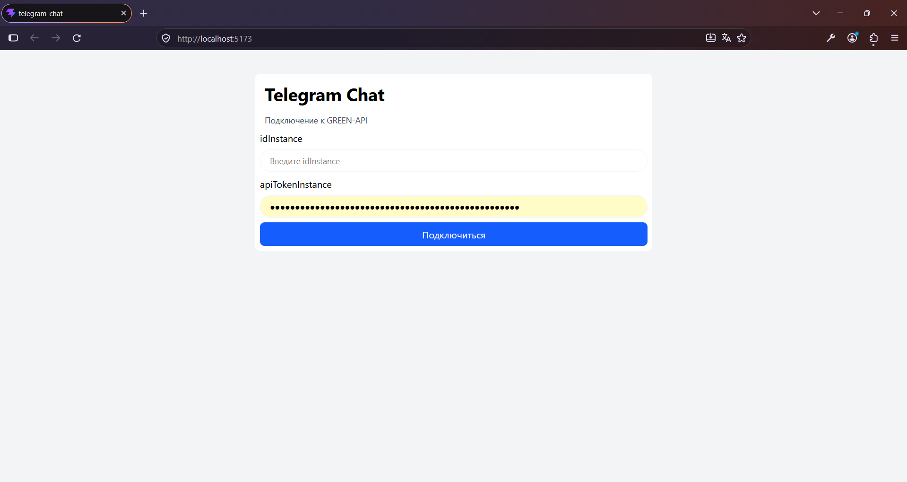
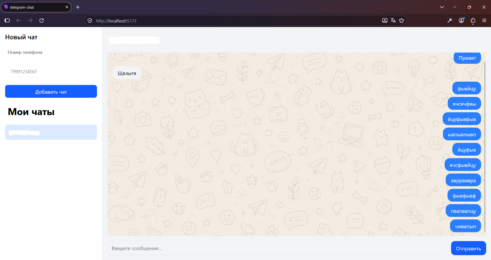

# Telegram Chat

Веб-приложение для обмена сообщениями в Telegram через GREEN-API.

Проект разработан на React и TypeScript в рамках тестового задания на позицию Frontend Developer.

## Онлайн-демонстрация

**[Открыть Telegram Chat](https://ivanyufin.github.io/green-api/)**

Для использования приложения необходимы действующие
apuUrl(в задании не был указан, добавлен на всякий случай, вдруг что-то изменится), idInstance и apiTokenInstance от GREEN-API.

## Технологии

- React
- TypeScript
- Vite
- Tailwind CSS
- GREEN-API
- Browser LocalStorage

## Возможности

- Подключение к GREEN-API по URL, ID инстанса и API-токену
- Поиск пользователей Telegram по номеру телефона
- Добавление собеседников в список чатов
- Переключение между переписками
- Отправка текстовых сообщений
- Автоматическое получение входящих сообщений
- Отправка по Enter, перенос строки по Shift + Enter
- Отображение входящих и исходящих сообщений
- Автоматическая прокрутка к последнему сообщению
- Сохранение списка чатов и истории сообщений в LocalStorage

## Установка и запуск

Для запуска необходимы **Node.js** и **npm**.

1. Клонируйте репозиторий:

   ```bash
   git clone https://github.com/ivanyufin/green-api.git
   ```

2. Перейдите в папку проекта:

   ```bash
   cd green-api/telegram-chat
   ```

3. Установите зависимости:

   ```bash
   npm install
   ```

4. Запустите сервер разработки:

   ```bash
   npm run dev
   ```

5. Откройте адрес, который Vite выведет в терминале (обычно `http://localhost:5173`).

## Подключение к GREEN-API

1. Создайте и настройте инстанс GREEN-API с поддержкой Telegram.
2. Получите `apiURL`, `idInstance` и `apiTokenInstance`.
3. Запустите приложение.
4. Укажите данные инстанса в форме авторизации.
5. После подключения добавьте собеседника по номеру телефона и откройте чат.

## Проверка проекта

Проверка TypeScript и создание production-сборки:

`npm run build`

Статический анализ кода:

`npm run lint`

## Структура проекта

- `telegram-chat/src/App.tsx` — основное состояние приложения и интеграция с API
- `telegram-chat/src/components/LoginForm.tsx` — форма подключения
- `telegram-chat/src/components/Sidebar.tsx` — боковая панель и список чатов
- `telegram-chat/src/components/ChatWindow.tsx` — окно переписки
- `telegram-chat/src/components/MessageBubble.tsx` — отображение сообщения
- `telegram-chat/src/types.ts` — общие типы TypeScript

## Ограничения

- Поддерживается обмен текстовыми сообщениями.
- История переписки сохраняется локально в браузере и не синхронизируется с полной историей Telegram.
- Сохранённые чаты и сообщения пока не разделяются по инстансам GREEN-API.
- После обновления страницы необходимо повторно подключиться к GREEN-API.
- API-токен не сохраняется в LocalStorage.

Проект предназначен для демонстрации работы с React, TypeScript и GREEN-API.


## Скриншоты

### Форма подключения



### Интерфейс переписки


